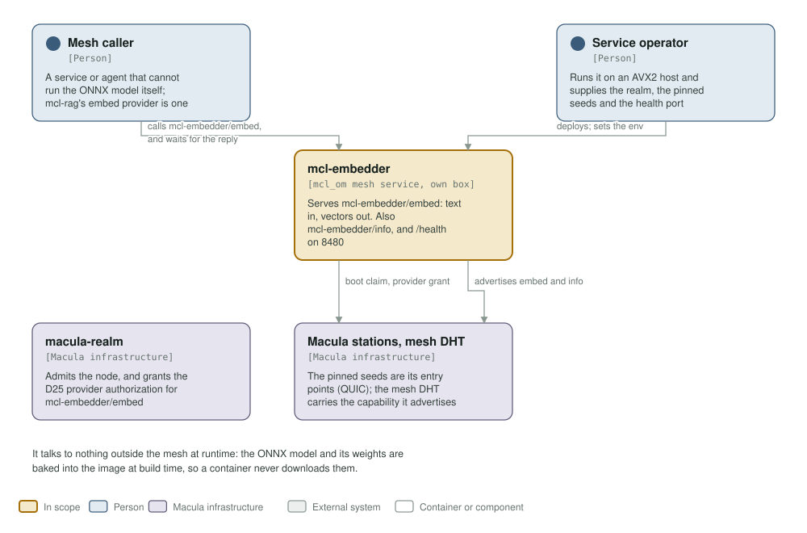
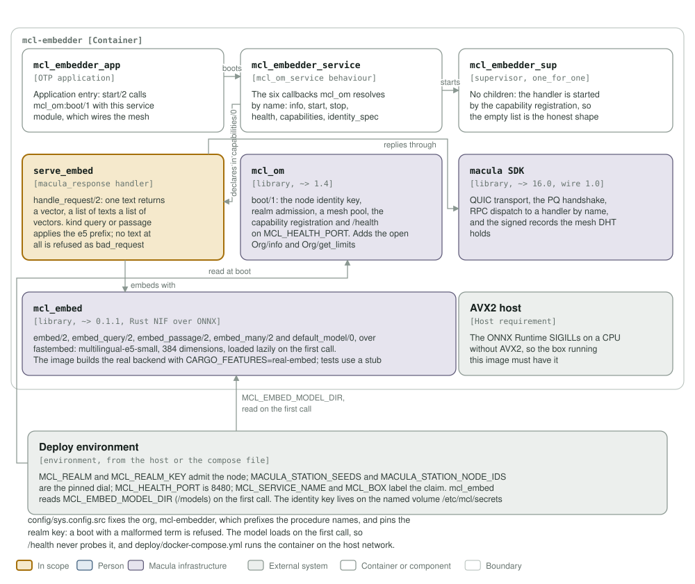

# mcl-embedder architecture: C4 model

*This exists so a reader can see what mcl-embedder talks to, and what it is made
of, without reading it.*

**Status: built and tested, not yet deployed.** One OTP release in one image,
run on an AVX2 host. It speaks wire 1.0 (`mcl_om` 1.4, macula 16) and is in no
fleet repository yet. It serves `mcl-embedder/embed` through the standard
capability path, and answers `/health` on 8480.

## Level 1: system context

| Element | Kind | Role |
| --- | --- | --- |
| mcl-embedder | In scope | `mcl-embedder/embed` is its own procedure, and the only one; `mcl_om` adds `mcl-embedder/info` and `mcl-embedder/get_limits` to every service, both open; `capabilities/0` is the list. Text in, vectors out, with `/health` on 8480. The model is baked into the image |
| Mesh caller | Person | A service or agent that cannot run the ONNX model itself. mcl-rag's `rag_embed_mcl_embedder` provider is one |
| Service operator | Person | Runs the image on an AVX2 host and supplies the realm, the pinned station seeds and the health port |
| macula-realm | Macula infrastructure | Admits the node and issues the D25 provider authorizations its org procedures need, `mcl-embedder/embed` among them; until it does, its own embed procedure is not advertised and `/health` is degraded |
| Macula stations, mesh DHT | Macula infrastructure | The pinned seeds are the node's entry points over QUIC; the DHT holds its own procedure's advert and carries what it publishes |

It talks to nothing outside the mesh at runtime. The ONNX model and its weights
are baked into the image at build time, so a container never downloads them, and
there is no store and no database.

## Level 2: containers and components

| Component | Technology | Responsibility |
| --- | --- | --- |
| `mcl_embedder_app` | OTP application | `start/2` calls `mcl_om:boot/1` with `mcl_embedder_service`, which wires the mesh, the realm identity and health before the service starts |
| `mcl_embedder_service` | the `mcl_om_service` behaviour | The six callbacks `mcl_om` resolves by name: `info/0`, `start/1`, `stop/1`, `health/0`, `capabilities/0`, `identity_spec/0`. `capabilities/0` declares its own procedure, `embed`, handled by `serve_embed` |
| `mcl_embedder_sup` | supervisor, `one_for_one` | No children: the handler is started by mcl-om's capability registration, so an empty child list is the honest shape, not a placeholder |
| `serve_embed` | `macula_response` handler | `handle_request/2`: one text returns a vector, a list of texts a list of vectors. `kind` `query` or `passage` applies the model's e5 prefix; a request with no text is refused as `bad_request` |
| `mcl_om` | library, `~> 1.4` | `boot/1`: loads the node identity key, joins the realm, opens the mesh pool, registers the declared capability and serves `/health` on `MCL_HEALTH_PORT`. Adds the open `Org/info` and `Org/get_limits`, which every service gets |
| macula SDK | library, `~> 16.0`, wire 1.0 | QUIC transport, the PQ handshake, RPC dispatch to a handler by name, and the signed records the mesh DHT holds |
| `mcl_embed` | library, `~> 0.1.1`, Rust NIF over ONNX | `embed/2`, `embed_query/2`, `embed_passage/2`, `embed_many/2` and `default_model/0` over fastembed: `multilingual-e5-small`, 384 dimensions, one `gen_server` per model wrapping the NIF and loaded lazily on the first call. The image builds the real backend (`CARGO_FEATURES=real-embed`); tests use a deterministic stub |
| AVX2 host | host requirement | The ONNX Runtime SIGILLs on a CPU without AVX2, taking the node with it, so the box running this image must have it |
| Deploy environment | environment | `MCL_REALM` and `MCL_REALM_KEY` admit the node; `MACULA_STATION_SEEDS` and `MACULA_STATION_NODE_IDS` are the pinned dial; `MCL_HEALTH_PORT` (8480) is the health endpoint, and `MCL_SERVICE_NAME` and `MCL_BOX` label the claim. `mcl_om` reads these at boot; `mcl_embed` reads only `MCL_EMBED_MODEL_DIR` (`/models`), on the first call. The identity key lives on the named volume `/etc/mcl/secrets` |

`config/sys.config.src` fixes the org, `mcl-embedder`, which prefixes
procedure names, and pins the realm key: a boot with a malformed term is
refused. The model loads on the first call, so `/health` never probes it.
`deploy/docker-compose.yml` runs the container on the host network, because the
stations are reachable over IPv6 only, and mounts the named volume
`mcl-embedder-secrets`.

**Where the station list comes from.** It is not in `config/sys.config.src`: `mcl_om` reads `MACULA_STATION_SEEDS` and `MACULA_STATION_NODE_IDS` from the environment at boot, paired index for index, so this repository pins no station and the list may be any length.

## Drawing them

`assets/c4-context.svg` and `assets/c4-components.svg` are generated by
`architecture/c4_diagrams.py` (`python3 architecture/c4_diagrams.py`), from the
code and never from this page: the callbacks in `mcl_embedder_service.erl`, the
handler in `serve_embed.erl`, the dependencies in `rebar.config`, the port and
volumes in the `Containerfile` and `deploy/docker-compose.yml`. When one of
those changes, the diagram changes in the same commit.

Two rules for the files themselves, so they render everywhere they are read
(GitHub, an IDE, `rsvg-convert`): self-contained SVG, and literal colours in
plain classes plus a `prefers-color-scheme` dark block, never CSS custom
properties, which `rsvg-convert` renders black.

The check that keeps them here is the `c4-model` job in
`.github/workflows/c4-model.yml`. It is red until both files exist and are
shown, and it stays red if either one goes missing.
